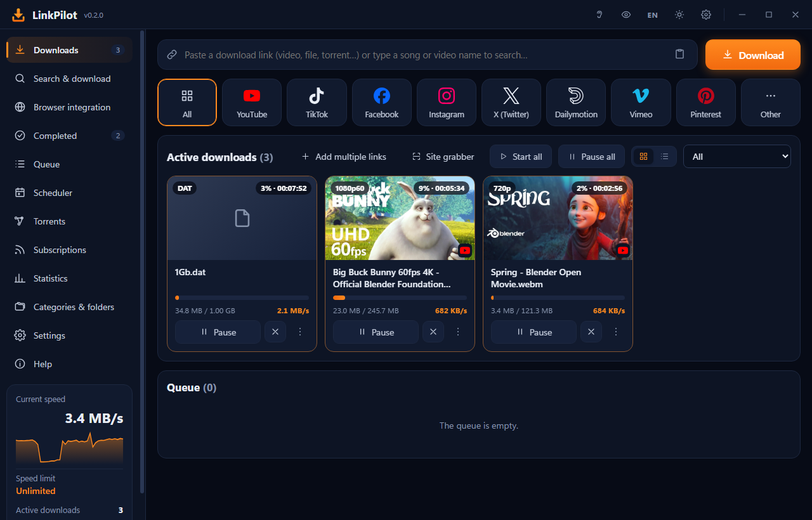
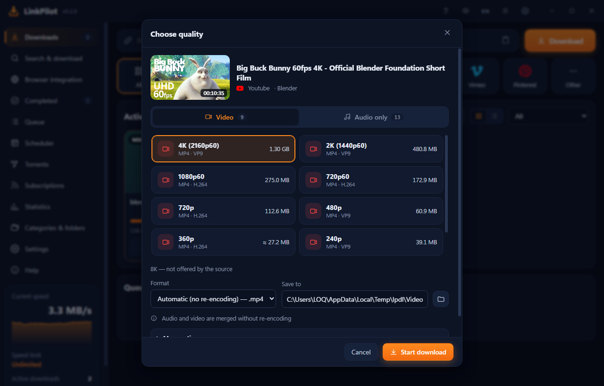
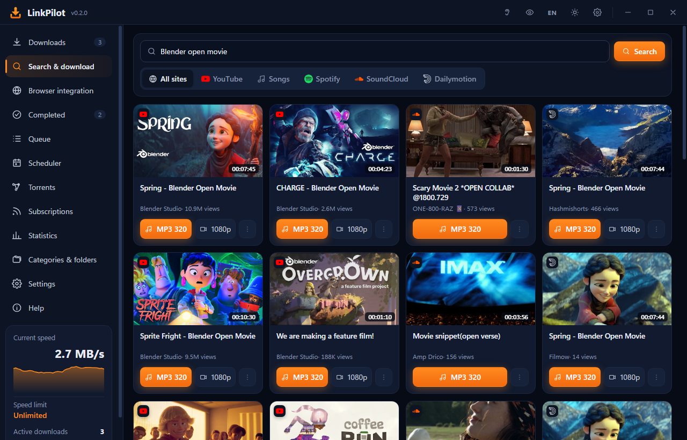
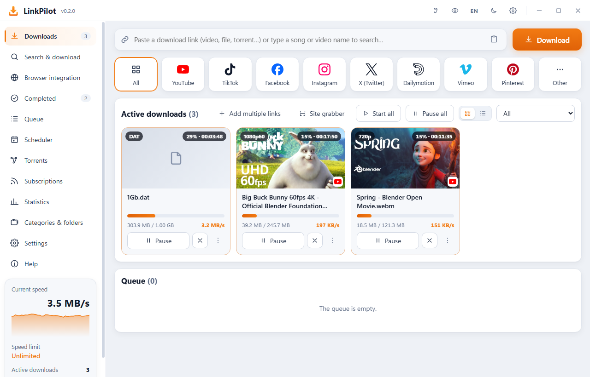
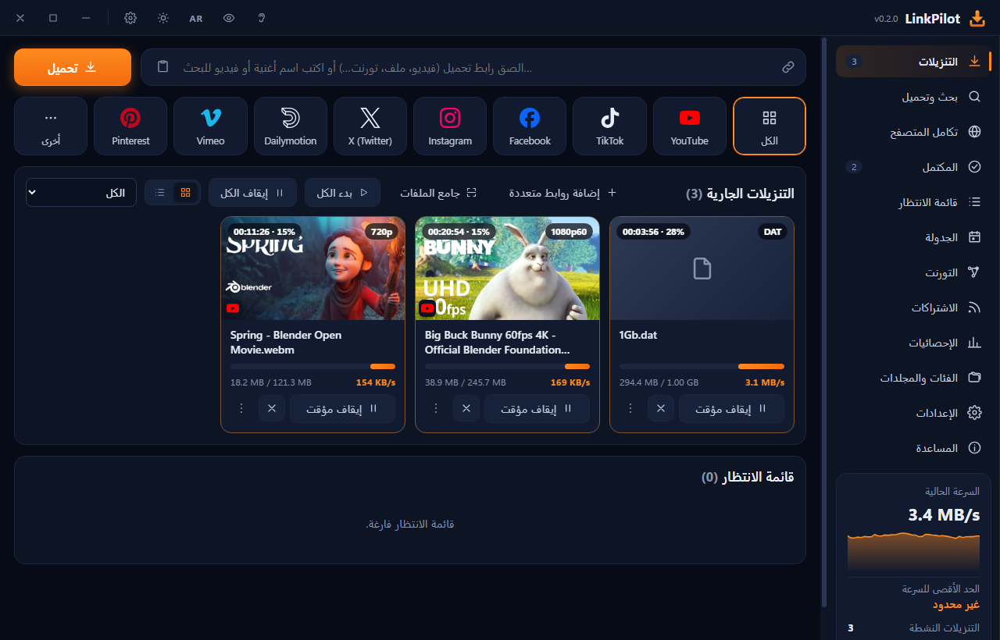
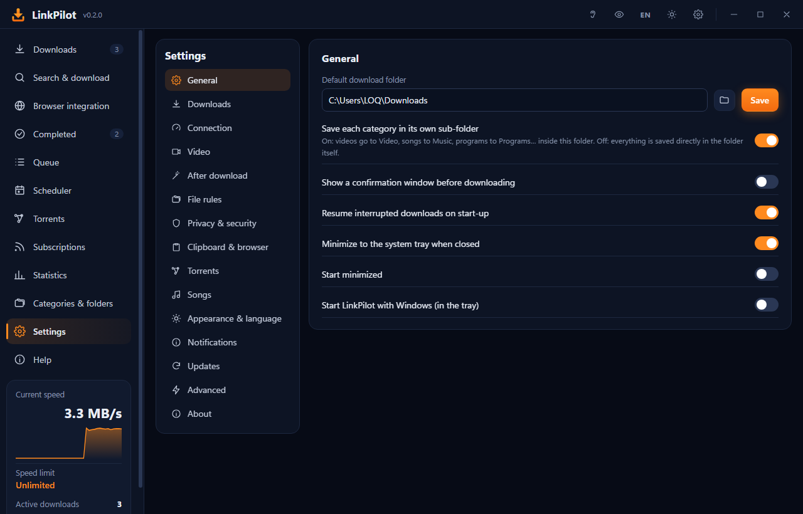
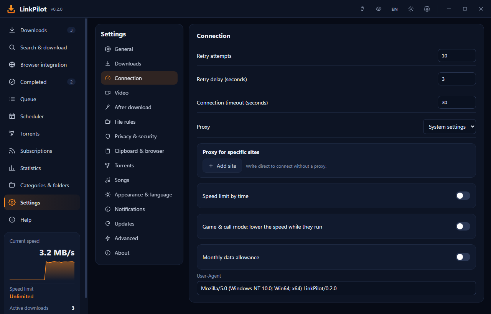

# LinkPilot

### The fast, modern download manager for Windows

Files, videos, music and torrents: one app, at full speed.

 

  

---

## Why LinkPilot?

<table>
<tr>
<td width="50%" valign="top">

### ⚡ Uses all of your bandwidth
Every file is split across up to **32 connections**. The speed booster keeps adding connections while the speed rises and adds more again if a server slows down mid-download. Pause, resume after a crash or a reboot, and pick up exactly where you left off.

</td>
<td width="50%" valign="top">

### 🎬 Video from almost any site
YouTube, TikTok, Facebook, Instagram, X, Vimeo, Dailymotion, Pinterest and thousands more, **from 144p up to 8K**. Get MP3 at 320 kbps, subtitles, chapters or just a clip of the video, and record live streams. It even reads the video players on movie and series sites.

</td>
</tr>
<tr>
<td width="50%" valign="top">

### 🔎 Search and download
Type a song or video name: LinkPilot searches YouTube, SoundCloud and Dailymotion together and gets it as **MP3 320** or video in one click. It also handles Spotify songs, albums and podcasts.

</td>
<td width="50%" valign="top">

### 🧲 Torrents built in
Magnet links and .torrent files, with no extra app needed. **Watch a video while it downloads**, pick only the files you want, and stop seeding when it finishes.

</td>
</tr>
<tr>
<td width="50%" valign="top">

### 🌐 Works with your browser
The extension for **Chrome, Edge and Brave** (Opera and Firefox too) sends browser downloads to LinkPilot and puts a download button just above any video. Alt + click any link to grab it.

</td>
<td width="50%" valign="top">

### 🔄 Always up to date
LinkPilot checks for new versions every two hours and tells you the new version number in a Windows notification. You can update in one click, or let it install by itself. Its video tools update on their own too.

</td>
</tr>
</table>

---

## Screenshots

**Pick any quality, from 144p to 8K, with the size of each one**

  

**Search and download: songs and videos from several sites at once**

  

<table>
<tr>
<td align="center"><b>Light theme</b> </td>
<td align="center"><b>Full Arabic interface (RTL)</b> </td>
</tr>
<tr>
<td align="center"><b>Simple settings</b> </td>
<td align="center"><b>Proxies, speed rules and data allowance</b> </td>
</tr>
</table>

---

## Everything it can do

| | |
|---|---|
| **Downloads** | Up to 32 connections per file · smart speed booster · resume after crashes and restarts · queues and scheduler · link renewal when a link expires · checksum checks |
| **Video & audio** | 144p → 8K · MP3 / M4A / FLAC / WAV · subtitles (and Arabic subtitles) · chapters · download part of a video · live recording · playlists and whole channels · SponsorBlock |
| **Music** | Search by name · Spotify songs, albums and podcasts · identify a song and fix its tags and cover |
| **Sources** | HTTP/HTTPS · torrents and magnets · FTP, FTPS, SFTP · Google Drive · MEGA · mirrors · site grabber · RSS and watched pages |
| **After download** | Extract archives · convert video/audio · Whisper subtitles · VirusTotal scan · run a script · shut down or sleep when done |
| **Control** | Speed limits by time of day · game & call mode (lowers speed while you play or call) · monthly data allowance · per-site proxy |
| **Privacy** | Private downloads · app lock · cookies stay on your PC and are only used for sites you allow |
| **Comfort** | Arabic & English · dark & light themes · cards or list view · clipboard watching · statistics · local API and command line |

---

## A closer look

### 🚀 Getting started
Paste any link into the bar at the top of the Downloads page and press **Download**. It can be a direct file, a video page, a magnet link, an FTP address or a Spotify link. You can also drag a link or a `.torrent` file straight onto the window.

- **File links** open the *Add download* window, where you can change the name, folder and category, and see the size and the free space before you start.
- **Video links** open the quality window.
- **Words instead of a link** start a search.

The Downloads page has two looks. **Cards** show big thumbnails and clear buttons. **List** is a quiet view with a live speed graph on top.

### ⚡ How LinkPilot gets your full speed
Most servers limit how fast a single connection can go. LinkPilot splits every file into parts and downloads them at the same time over several connections, then joins them into one file.

- **The speed booster** starts with your chosen number of connections. It measures the real speed once they are all flowing, then keeps adding connections while the speed keeps rising, up to 32 per file. When adding more stops helping, it stops there.
- **It keeps watching.** If a server gets slower in the middle of a download, for example after moving you to a busier node, the booster searches again and opens more connections.
- **Slow connections get help.** When one connection falls behind, the fast ones take over part of its work, so a single bad route can't hold the whole file at the end.
- **Writing never slows the network.** The file is written to disk on its own thread with a large buffer, so a slow disk moment doesn't pause your downloads.
- **Nothing is lost.** Progress is saved safely every couple of seconds. After a dropped connection, a crash or a restart, LinkPilot continues from where it stopped. If a link expires, it can fetch a fresh one through the browser extension and carry on from the same point.

Some servers allow only a few connections per user, and on those the server sets the speed. Mirrors help there: add other addresses of the same file, and LinkPilot spreads the connections over all of them.

### 🎬 Video and audio
The quality window lists every quality the site offers, **from 144p up to 8K**, each with its size. It also lists audio-only choices: original M4A, MP3 at 320, 192 or 128 kbps, WAV and FLAC. You get these choices on every site, even ones that only offer complete files, like TikTok.

- **Subtitles:** pick languages and get `.srt` files or subtitles inside the video. Automatic captions are used when there are no real ones. An **Arabic subtitles** switch appears when the video has Arabic subtitles or Arabic speech.
- **Chapters:** save each chapter as its own file, or download only some of them.
- **Part of a video:** set *From* and *To* (for example 1:05 to 3:20) on a timeline under the video, and only that part is downloaded.
- **Live streams** are recorded until they end or you stop them, from the beginning when the site allows it.
- **Playlists and channels:** you get a list of their videos with check boxes, even with thousands of videos, from YouTube or any other site. Choose one quality for all of them (video, or audio as M4A / MP3), tick the videos you want or pick a range by number, and they download one after another.
- **Clean files:** titles lose extras like `(Official Video) [4K] #shorts`, SponsorBlock can cut sponsor segments from YouTube videos, and the title, details and cover picture are written into the file.
- **TikTok:** every quality TikTok offers, without the watermark. There's also a copy *with* the watermark, and the original song used in the clip.

### 🎞️ Movie and series sites
Many movie and series sites play their videos through outside "servers" (StreamWish, VidTube, UpDown, Uqload, EarnVids/Filelions, Doodstream and others) that ordinary video tools don't support. LinkPilot opens the server's player page itself, unpacks its script and finds the real video stream. It then downloads that stream with all qualities, sending the headers the server expects.

A few servers build the video link only while it plays. For those, play the video in your browser first and then press the LinkPilot button, and the extension hands over the stream it saw. When a server refuses downloads completely, LinkPilot tells you so, and you can pick another server on the site.

### 🔎 Search, songs and Spotify
Type any song or video name, on the Search page or straight into the link bar. LinkPilot searches **YouTube, SoundCloud and Dailymotion together** and shows each result with its picture, length and views. **MP3 320** gets the sound in one click, the quality button gets the video, and **⋮** opens every quality.

- **Songs tab:** searches YouTube Music's catalogue by title, artist and album, and downloads MP3s with their details and cover written in.
- **Spotify:** paste any song, album, playlist or podcast link. Spotify's own audio is protected, so LinkPilot finds the same song on YouTube Music by title, artist and length, downloads it, and writes in Spotify's title, artist, album and cover. Podcasts download from their official feed, and you can subscribe so new episodes arrive by themselves.
- **"Which song is playing?":** listens to 10 seconds of whatever your computer is playing and names the song. You can also identify a finished file and fix its tags.

### 🌐 The browser extension
Once installed (in Chrome, Edge or Brave; Opera and Firefox work too), downloads you start in the browser go to LinkPilot automatically.

- **A LinkPilot button** sits just above every video on any site and is hidden while the video is full screen. On YouTube's home, search and channel pages, it downloads the video you're previewing.
- **The toolbar icon** lists every video and stream found on the page, with its qualities on two tabs, *Video* and *Audio*.
- **Alt + click** any link to download it with LinkPilot, or **Alt + Shift + click** to leave it to the browser.
- **Signed-in sites:** allow a site to share your browser session, and files that need you to be signed in download normally. Its cookies go only to LinkPilot on your own computer.

### 🧲 Torrents
Paste a magnet link or open a `.torrent` file, pick only the files you want, and set download and upload limits. **Watch now** plays a video while it is still downloading: LinkPilot fetches the parts the player needs first. Seeding stops when the download completes, unless you change that.

### 🌍 More places to download from
- **FTP, FTPS and SFTP**, with resume. Passwords are taken out of the link and stored encrypted.
- **Google Drive, Docs and Dropbox:** normal sharing links become direct downloads.
- **MEGA:** files are downloaded and decrypted on your computer, and the key never leaves it.
- **Site grabber:** lists every file, picture and video a page links to, so you can filter by type and add them all at once.
- **Subscriptions:** new videos from a channel or playlist, new podcast episodes, or a new version of a file you watch, all downloaded by themselves.

### 🗂️ Organised automatically
Every download goes into a folder for its kind: Video, Music, Documents, Programs, Compressed and so on. You can turn that off and keep everything in one folder. **Save rules** go further: by site (github.com → Code), by extension, or by a word in the file name. Before downloading, LinkPilot warns you if the link is already in your list or a file with that name already exists.

### 🕹️ You stay in control
- **Queues and scheduler:** group downloads, each queue with its own number of simultaneous downloads. Start a queue at a set time, once, daily or on chosen days. When it finishes, LinkPilot can do nothing, close, sleep the PC or shut it down, with a countdown you can cancel.
- **Speed limits:** a global limit, one per download, or by time of day (for example 1 MB/s from 9:00 to 17:00).
- **Game & call mode:** while a game, a full-screen program, Zoom or Teams is running, LinkPilot slows down so your ping stays low.
- **Monthly data allowance:** set your allowance and renewal day. LinkPilot warns you at 90% and can pause at the limit.
- **Per-site proxy:** send one site through a proxy or VPN and the rest directly.

### 🛠️ After the download
Each of these runs on its own when a file finishes. You can also run any of them on a finished file from its **⋮** menu:
- **Extract** zip, rar, 7z and more.
- **Convert** to an MP4 that plays everywhere, compress to 720p, or extract MP3/M4A. The original is kept.
- **Create subtitles with AI (Whisper)** for any video, entirely on your computer. You get an `.srt` file or subtitles burned in, with your choice of font, colour and position.
- **Prepare for WhatsApp:** LinkPilot picks the quality so a video fits a status (16 MB) or a message (64 MB). It can also cut a part or make a GIF.
- **Check for viruses** with Microsoft Defender or VirusTotal (only the file's checksum is sent), or **run your own script**.

### 🔒 Privacy
**Private downloads** stay out of statistics and notifications and leave the list once opened. LinkPilot can lock itself with **Windows Hello** (face, fingerprint or PIN) or a password. Keys, passwords and cookies are encrypted for your Windows account, and LinkPilot has no telemetry at all. [Read the privacy page](PRIVACY.md).

### 🧑‍💻 For power users
- **Local API** on 127.0.0.1, with a token. aria2-compatible tools work at `/jsonrpc`.
- **Command line:** `linkpilot.exe --add <link>`, `--add-list file.txt`, `--pause-all`, `--start-queue`, plus IDM-style switches.
- **Export and import** your list, settings and subscriptions to move them to another PC. Passwords are never exported.
- **Portable mode:** put a file named `portable.txt` next to `linkpilot.exe`, and everything stays in a folder beside it. You can run it from a USB stick.

---

## Install

1. Download **`LinkPilot_x.y.z_x64-setup.exe`** from the [latest release](https://github.com/AdhamHammam2023/LinkPilot/releases/latest).
2. Run it. No admin rights needed.
3. **Windows SmartScreen** may warn you because the app isn't code-signed yet: click **More info → Run anyway**.
4. Optional: open **Browser integration** in LinkPilot and follow the steps to add the browser extension.

> **Requirements:** Windows 10 or 11 (64-bit). LinkPilot downloads its video tools (yt-dlp, FFmpeg, Deno) from their official sources the first time you need them, and checks each one's SHA-256.

## Updates

Already have LinkPilot? You don't need to come back here. From version **0.2.0**, LinkPilot finds new versions by itself and shows a notification with the new version number. Choose **Settings → Updates → Auto** to have them installed without asking.

*If you have version 0.1.0, install the latest release once by hand. Every update after that arrives automatically.*

## Documentation

| | |
|---|---|
| 📦 [Install guide](INSTALL.md) | Setup, video tools and the browser extension |
| 📝 [Changelog](CHANGELOG.md) | What's new in every version |
| ❓ [FAQ](FAQ.md) | Speed, SmartScreen, video sites, updates |
| 🔒 [Privacy](PRIVACY.md) | What LinkPilot connects to, and what it never does |
| 🛡️ [Security](SECURITY.md) | How updates are verified, and how to report a problem |
| 🙋 [Support](SUPPORT.md) | Where to get help |
| 📜 [Third-party notices](THIRD_PARTY_NOTICES.md) | The open-source components inside LinkPilot |

---

Built with [Tauri](https://tauri.app) · Rust · Svelte. Video support by [yt-dlp](https://github.com/yt-dlp/yt-dlp) and [FFmpeg](https://ffmpeg.org), torrents by [librqbit](https://github.com/ikatson/rqbit).

Made by **Adham Hammam**

